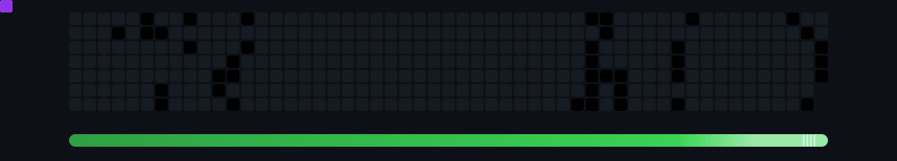

<!--- hero banner --->

  

---

<!--- introduction --->
<h1 align="center">Hi , I'm Probir Ghosh</h1>

I'm a **Full-Stack Web Developer** focused on building complete applications with TypeScript, React, Next.js, Node.js, and PostgreSQL. I also bring 3+ years of web development teaching experience from Programming Hero.

---

<!--- about --->
## About Me 

- **Development Focus** — Full-stack application development with TypeScript.
- **Teaching Background** — 3+ years of web development instruction at [Programming Hero](https://www.programming-hero.com/).
- **Backend Interests** — REST APIs, authentication, authorization, and relational database design.
- **Engineering Approach** — Clean architecture, readable code, and maintainable solutions.

---

<!--- socials --->
## Connect With Me 

  
  &nbsp;&nbsp;
  

---

<!--- technology --->
## Languages and Tools 

  <strong>Languages</strong> 
  &ensp;&ensp;&ensp;&ensp;&ensp;&ensp;

  <strong>Frontend</strong> 
  &ensp;&ensp;&ensp;&ensp;

  <strong>Backend</strong> 
  &ensp;&ensp;

  <strong>Database &amp; ORM</strong> 
  &ensp;&ensp;&ensp;&ensp;

  <strong>Tools &amp; Platforms</strong> 
  &ensp;&ensp;&ensp;&ensp;&ensp;&ensp;

---

<!--- current stats --->
## Current Stats

  

---

<!--- statistics --->
## GitHub Statistics & Analysis

### GitHub Contributions

  

### GitHub Statistics

|  |  |
| :---: | :---: |

---

<!--- featured projects --->
## Featured Projects

### Prisma Blog API

**Stack:** TypeScript · Express · Prisma · PostgreSQL · Better Auth

A TypeScript REST API for a blogging platform with posts, comments, and session-based authentication. Built with Express, Prisma, and PostgreSQL, including email support via Nodemailer.

[Repository](https://github.com/probirghoshdev/prisma-blog-app)

### Next.js Blog Client

**Stack:** Next.js · TypeScript · Tailwind CSS · shadcn/ui

A Next.js App Router project written in TypeScript, using Tailwind CSS and shadcn/ui for the component layer.

[Repository](https://github.com/probirghoshdev/next-blog-client)

### Healthcare Management Backend

**Stack:** TypeScript · Express · Prisma · PostgreSQL · Better Auth

A backend for a healthcare management platform, structured around a route–controller–service architecture with Prisma and PostgreSQL.

[Repository](https://github.com/probirghoshdev/ph-health-care-backend)

### Ride Booking API

**Stack:** Node.js · Express · TypeScript · MongoDB · Mongoose · JWT · Zod

A RESTful API for a ride booking platform supporting riders, drivers, and admins, with role-based access control and the full ride lifecycle.

[Repository](https://github.com/probirghoshdev/goride-backend) &nbsp;·&nbsp; [Live API](https://a-5-gamma.vercel.app)

---

<!--- learning --->
## Currently Learning

- Advanced TypeScript patterns and type-safe API design
- Next.js App Router and server-side data fetching
- Backend architecture and scalable API design
- PostgreSQL query optimization and data modeling

---

<!--- closing --->
## Let's Connect

  <i>Building, learning, and growing — one production-ready feature at a time.</i>

  <a href="https://www.linkedin.com/in/probirghoshdev/">Reach me on LinkedIn</a>

  

