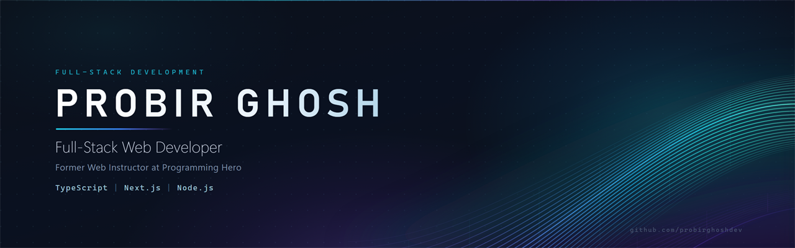

  

  
  

---

## About Me

I am a full-stack web developer with a background in teaching. I spent 3+ years at Programming Hero helping learners understand the web development stack, and I now apply that same clarity to designing and building applications end to end.

- Former Web Instructor at **Programming Hero**
- 3+ years of experience in web development education
- Focused on **full-stack development** with TypeScript across the stack
- Interested in backend architecture, database design, and API development
- Care about readable code, consistent project structure, and maintainable patterns

---

## Technical Skills

**Languages**

  

**Frontend**

  

**Backend**

  

**Database &amp; ORM**

  

**Tools**

  

---

## Featured Projects

### Prisma Blog API

TypeScript · Express · Prisma · PostgreSQL · Better Auth

A TypeScript REST API for a blogging platform with posts, comments, and session-based authentication. Built with Express, Prisma, and PostgreSQL, including email support via Nodemailer.

[Repository](https://github.com/probirghoshdev/prisma-blog-app)

### Next.js Blog Client

Next.js · TypeScript · Tailwind CSS · shadcn/ui

A Next.js App Router project written in TypeScript, using Tailwind CSS and shadcn/ui for the component layer.

[Repository](https://github.com/probirghoshdev/next-blog-client)

### Healthcare Management Backend

TypeScript · Express · Prisma · PostgreSQL · Better Auth

A backend for a healthcare management platform, structured around a route–controller–service architecture with Prisma and PostgreSQL.

[Repository](https://github.com/probirghoshdev/ph-health-care-backend)

### Ride Booking API

Node.js · Express · TypeScript · MongoDB · Mongoose · JWT · Zod

A RESTful API for a ride booking platform supporting riders, drivers, and admins, with role-based access control and the full ride lifecycle.

[Repository](https://github.com/probirghoshdev/goride-backend) &nbsp;·&nbsp; [Live API](https://a-5-gamma.vercel.app)

---

## GitHub Statistics

  
  

---

## GitHub Streak

  

---

## Contribution Activity

  

---

## Currently Learning

- Advanced TypeScript patterns and type-safe API design
- Next.js App Router and server-side data fetching
- Backend architecture and scalable API design
- PostgreSQL query optimization and data modeling

---

  <i>Building, learning, and growing — one production-ready feature at a time.</i>

  <a href="https://www.linkedin.com/in/probirghoshdev/">Let's connect on LinkedIn</a>

